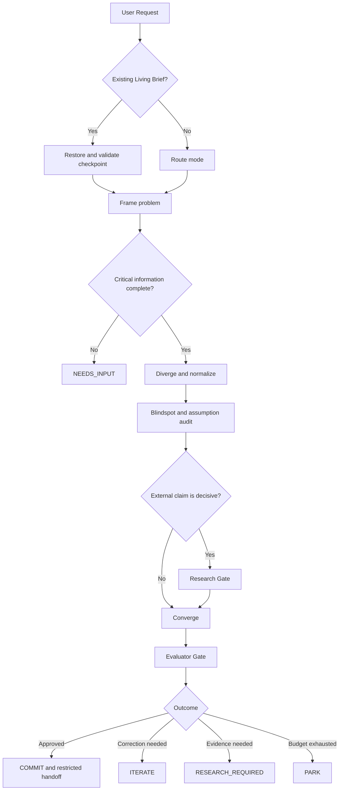

# Brainstorm Governor

> 一个面向 Codex 的质量门禁型头脑风暴 Skill：把开放式创意请求转化为可恢复、可审计、可验证的概念决策流程。

`brainstorm-governor` 不以“生成尽可能多的点子”为目标，而是把概念塑形、风险发现、证据核验、方案收敛和交付门禁组织成一条受约束的工作流：

```text
Frame → Diverge → Challenge → Research → Converge → Evaluate → Handoff
```

项目当前处于 **Local Contract Full Version**：P0–P6 的状态、持久化、预算、隔离、追踪、质量和发布合同已经完成本地验收；真实 Research、Worker、Evaluator 与多模型 Council Provider 仍需由部署方接入。

## 核心能力

- **四模式路由**：根据请求风险与成熟度在 `Spark`、`Shape`、`Stress`、`Decide` 之间选择合适强度。
- **Living Brief**：将运行状态持久化为可恢复的概念简报，支持 revision、CAS、状态哈希和幂等续跑。
- **挑战与证据门禁**：分离 Blindspot、Assumption Audit、Pressure Test 和 Research Gate，防止把推断当事实。
- **安全的外部执行边界**：Research 与 Worker 结果先进入 staging，通过校验后再 copy-on-write 提交；失败不会污染主状态。
- **有界质量循环**：Evaluator 最多运行两轮，只有当前 revision 下通过质量门禁且哈希匹配的 artifact 才能 handoff。
- **可观测与发布门禁**：记录阶段、checkpoint、外调、usage 和成本；关键版本指纹变化会触发回归检查。

## 工作原理



合法终止状态包括：`EXPLORE`、`RESEARCH_REQUIRED`、`ITERATE`、`COMMIT`、`PARK` 和 `NEEDS_INPUT`。运行时不会为了得到“完整答案”而伪造缺失信息。

## 运行模式

| 模式 | 适用场景 | 默认策略 |
|---|---|---|
| `Spark` | 低风险、快速创意 | 轻量发散，单 Agent |
| `Shape` | 模糊概念塑形 | 补全 Problem Frame，默认模式 |
| `Stress` | 已有方案需要验证 | 强化盲点、假设和失败路径 |
| `Decide` | 高成本或难逆的多方案决策 | 完整证据、权衡和质量门禁 |

显式指定的模式优先级最高；自动路由可以升级复杂度，但不会静默降低已有运行的复杂度。

## 快速开始

### 环境要求

- Python 3.10+
- 使用仓库内置的 JSON-compatible YAML 示例时，无第三方运行时依赖
- 只有使用普通 YAML 语法时才需要可选依赖 `PyYAML`

### 1. 运行示例请求

在项目根目录执行：

```bash
python scripts/brainstorm.py run \
  --request tests/acceptance/fixtures/ac01_one_command.json \
  --config config/brainstorm-governor.example.yaml \
  --brief CONCEPT_BRIEF.md
```

PowerShell：

```powershell
python scripts/brainstorm.py run `
  --request tests/acceptance/fixtures/ac01_one_command.json `
  --config config/brainstorm-governor.example.yaml `
  --brief CONCEPT_BRIEF.md
```

命令会：

1. 校验配置和请求；
2. 创建或恢复 `CONCEPT_BRIEF.md`；
3. 运行到某个合法终止状态；
4. 输出机器可读的 JSON 摘要；
5. 写入关联的 append-only Trace。

典型输出字段：

```json
{
  "run_id": "run-ac01-one-command",
  "mode": "Shape",
  "exit_status": "NEEDS_INPUT",
  "brief_path": ".../CONCEPT_BRIEF.md",
  "next_action": "provide the missing Problem Frame information",
  "resumed": false
}
```

> 示例请求故意缺少完整 Problem Frame，因此诚实停止在 `NEEDS_INPUT`；这属于成功的合法停止，不是运行失败。

### 2. 从 stdin 读取请求

省略 `--request` 或传入 `--request -` 时，CLI 从标准输入读取 JSON：

```bash
echo '{"text":"为小型产品团队塑形一个可逆的 onboarding 概念","routing":{"ambiguous_concept":true}}' \
  | python scripts/brainstorm.py run --request - \
      --config config/brainstorm-governor.example.yaml \
      --brief CONCEPT_BRIEF.md
```

请求顶层字段：

| 字段 | 必需 | 说明 |
|---|---:|---|
| `text` | 是 | 非空的原始请求 |
| `request_id` | 否 | 调用方提供的稳定运行 ID |
| `routing` | 否 | 路由信号，例如 `ambiguous_concept` |
| `core` | 否 | 完整的 P1 结构化输入；省略时按最小 Frame 运行 |

### 3. 恢复已有运行

再次使用同一 `--brief` 路径运行同一命令即可恢复：

```bash
python scripts/brainstorm.py run \
  --request request.json \
  --config config/brainstorm-governor.example.yaml \
  --brief CONCEPT_BRIEF.md
```

恢复前会校验 Brief revision、checkpoint envelope、文件摘要、主状态哈希和 Trace cursor。CAS 冲突、状态篡改或不兼容的 checkpoint 会硬停止，不会静默重建状态。

### 4. 在 Codex 中使用 Skill

仓库内的 Skill 位于 `.agents/skills/brainstorm-governor/`。自然语言示例：

```text
请帮我塑形这个模糊产品构想，先找盲点，再给出 2–3 个可验证方向。
```

显式调用示例：

```text
$brainstorm-governor
用 Decide 模式比较以下三个方案。外部事实必须有证据，输出 cheapest test，
不要进入实施规划。
```

## 配置

默认配置见 [`config/brainstorm-governor.example.yaml`](config/brainstorm-governor.example.yaml)，严格 Schema 见 [`config/brainstorm-governor.schema.json`](config/brainstorm-governor.schema.json)。

```yaml
{
  "schema_version": 1,
  "runtime": {
    "mode": "auto",
    "parallelism": 1,
    "budget": {
      "max_steps": 32,
      "max_parallelism": 1
    }
  },
  "persistence": {
    "brief_path": "./CONCEPT_BRIEF.md"
  },
  "features": {
    "research": false,
    "workers": false,
    "council": false,
    "evaluator": false
  },
  "evaluation": {
    "max_rounds": 2
  }
}
```

关键约束：

- `runtime.mode` 只能是 `auto`、`Spark`、`Shape`、`Stress` 或 `Decide`。
- `parallelism` 不得超过 `budget.max_parallelism`。
- `council=true` 要求同时设置 `workers=true`。
- `evaluation.max_rounds` 最大为 `2`。
- Feature 开关只允许进入对应门禁；缺少 Provider/Executor 时不会自动发起外部调用。

## 项目架构

```text
.
├── .agents/skills/brainstorm-governor/  # Codex Skill、阶段脚本、参考与合同测试
├── scripts/                             # 单命令入口与整体 smoke test
├── runtime/                             # 状态机、checkpoint、预算、事务、handoff
├── adapters/                            # Research、Worker、Evaluator 运行时边界
├── persistence/                         # Brief 迁移
├── observability/                       # Trace、事件与 usage ledger
├── artifacts/                           # Artifact writer 与 manifest
├── config/                              # Schema、示例配置与 Provider 定价
├── evals/                               # 版本指纹、场景回归与 baseline
├── ci/                                  # Skill 校验和回归发布门禁
├── acceptance/                          # Full Version manifest 与验收报告
└── tests/                               # 项目级单元测试与验收测试
```

### P0–P6 职责

| 阶段 | 职责 | 主要产物 |
|---|---|---|
| P0 | State Schema 与 Router | 运行模式、预算和状态不变量 |
| P1 | 单 Agent 核心闭环 | Frame、候选方向、收敛结果 |
| P2 | Persistence 与 Re-entry | Living Brief、revision、checkpoint |
| P3 | Challenge Engine | 盲点、假设审计、压力测试 |
| P4 | Evidence 与 Research Gate | 经引用支持校验的证据摘要 |
| P5 | Isolated Workers 与可选 Council | 隔离候选、分歧与综合输入 |
| P6 | Evaluator、Tracing 与 Handoff | 质量结果、artifact、受限交付 |

## 一致性与安全设计

- **事实分层**：状态中的知识明确标记为 `KNOWN`、`ASSUMPTION`、`UNKNOWN` 或 `CONFLICT`。
- **锁定决策**：`LOCKED` 决策只能通过显式更新路径修改，并记录变更原因。
- **幂等预算**：每个阶段或外调前持久化 budget charge；恢复不会重复扣费。
- **事务隔离**：外部结果只写 staging，通过 Schema、引用与冲突校验后一次提交。
- **失败隔离**：运行故障只进入 append-only failure ledger，不会成为事实、候选或推荐。
- **真实 usage**：只接受 Provider 返回的 usage；缺失值记为 `UNAVAILABLE`，不会估算为零成本。
- **Artifact 绑定**：handoff 前复核 run、Brief revision、quality gate、文件存在性和 SHA-256。
- **外部内容降权**：外部文本统一视为 `DATA_ONLY`，不能直接成为控制指令。

## 外部集成边界

默认单命令路径当前实际编排 P0/P1/P2。P4/P5/P6 已提供经过验收的 Python API 和事务化边界，但真实后端及其默认路径接线由宿主提供。

| 接口 | 责任 | 当前状态 |
|---|---|---|
| `ResearchProvider` | 检索并返回结构化证据摘要 | 接口完成，真实 Provider 未接入 |
| `CitationSupportChecker` | 判断引用是否支持具体主张 | 接口完成，真实实现未接入 |
| `IsolatedWorkerExecutor` | 隔离执行探索或研究任务 | 接口完成，真实 Executor 未接入 |
| `CouncilProviderAdapter` | 调用独立模型并归一化结果 | Provider 合同完成，HTTP Adapter 未接入 |
| `Evaluator` / `Optimizer` | 返回并落实字段级修正 | 门禁完成，真实模型未接入 |
| `ArtifactWriter` / `HandoffGate` | 写入、绑定并校验最终交付 | 已实现 |

Council 配置已经覆盖 DeepSeek、Kimi/Moonshot 和 MiniMax，但模型 ID 与密钥由部署环境显式提供；仓库不会发送真实 HTTP 请求，也不会将单模型角色扮演标记为多模型 Council。

## 测试与发布验证

运行项目测试：

```bash
python -m unittest discover -s tests -q
```

运行 P0–P6 合同测试：

```bash
python -m unittest discover -s .agents/skills/brainstorm-governor/tests -q
```

运行完整验证链：

```bash
python evals/live_runner.py run
python ci/regression_gate.py check
python acceptance/full_version.py run
python scripts/agent_smoke.py
```

仓库内当前验收基线：

| 验证项 | 结果 |
|---|---:|
| P0–P6 合同测试 | 108 / 108 PASS |
| 项目级测试 | 90 / 90 PASS |
| Live local regression | 16 / 16 PASS |
| AC-01～AC-08 | 8 / 8 PASS |
| Agent smoke | 6 / 6 PASS |
| Full Version Release Gate | `FULL_VERSION / PASS` |

可复核报告：

- [`acceptance/report.md`](acceptance/report.md)：Full Version 验收结果
- [`acceptance/manifest.json`](acceptance/manifest.json)：AC-01～AC-08 定义
- [`acceptance/agent-functional-report.json`](acceptance/agent-functional-report.json)：整体 Agent smoke
- [`evals/live-report.json`](evals/live-report.json)：本地 live regression
- [`evals/gate-report.json`](evals/gate-report.json)：当前版本回归门禁

当 prompt、model、Provider、adapter、Schema、citation checker 或 pricing 指纹变化时，需要重新运行 live regression，并通过显式 baseline 审批后才能恢复 `ALLOW`。回归门禁不会自动接受失败结果。

## 当前边界

`FULL_VERSION` 仅表示仓库内的本地运行、安全和发布合同已经通过验收，不代表：

- 真实搜索或 citation checker 已上线；
- 真实 Worker、Evaluator 或 Optimizer 已连接；
- DeepSeek、Kimi、MiniMax 的 HTTP 调用已实现；
- 本地回归等同于外部模型语义评测；
- Governor 会继续执行项目实施计划。

本项目的最终职责是产出经过门禁的概念 handoff；实施与交付执行明确位于边界之外。

## 进一步阅读

- [`FULL_VERSION_ACCEPTANCE_PLAN.md`](FULL_VERSION_ACCEPTANCE_PLAN.md)：完整验收标准、故障矩阵与 Release Gate
- [`FV_BUILD_LOG.md`](FV_BUILD_LOG.md)：FV-00～FV-08 构建记录与剩余边界
- [`.agents/skills/brainstorm-governor/SKILL.md`](.agents/skills/brainstorm-governor/SKILL.md)：Skill 的运行规则和阶段约束

## License

当前仓库未提供 `LICENSE` 文件。在添加明确许可证之前，默认不授予复制、修改或分发权利。
