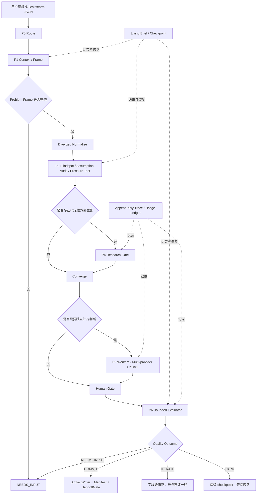

# Brainstorm Governor

> 一个面向 Codex 的质量门禁型头脑风暴 Agent：把开放式创意请求转化为可恢复、可审计、受证据约束且能够被验证的概念决策。

`brainstorm-governor` 不追求无边界地产生点子。它负责定义问题、生成机制不同的候选方向、暴露假设和风险、按需引入外部证据与独立模型，并只在质量门通过后产出受限 handoff。

它的工作边界止于“经过验证的概念交付”，不会自动进入产品开发、技术架构设计或实施执行。

## 当前状态

仓库已经完成 P0–P6 本地合同，并提供真实 OpenAI-compatible Council 与 Evaluator 的通用适配边界。

| 能力 | 通用合同 | 默认根命令自动接线 | 外部接入边界 |
|---|---:|---:|---|
| P0 路由与状态验证 | 已完成 | 已接线 | 无外部依赖 |
| P1 单 Agent 核心循环 | 已完成 | 已接线 | 无外部依赖 |
| P2 Living Brief 与恢复 | 已完成 | 已接线 | 文件持久化 |
| P3 Challenge Engine | 已完成 | 由结构化核心输入驱动 | 无外部依赖 |
| P4 Research / 引用支持 | 已完成 | 需要宿主 Provider | Provider-neutral 接口 |
| P5 Isolated Workers | 已完成 | 需要宿主 Executor | 隔离执行接口 |
| P5 多模型 Council | 已完成 | 不自动外调 | OpenAI-compatible HTTP 适配器 |
| P6 Evaluator / Trace / Handoff | 已完成 | 不自动外调 | Evaluator、usage、artifact 与 manifest 接口 |
| FV-07 回归发布门 | 已完成 | 独立执行 | 当前结果 `ALLOW` |

`scripts/brainstorm.py` 是通用、安全的单命令入口，当前自动编排 P0/P1/P2，并运行到合法停止状态。P4/P5/P6 提供通用合同和适配器，由宿主在通过配置、门禁和用户授权后显式接入；根命令不会自动发起网络调用。

### 本阶段沉淀的通用改进

- Council 从“仅有合同”扩展为可接入真实 OpenAI-compatible Provider 的通用 HTTP 适配器，同时保留 Provider 隔离、成功数门槛和多 Provider 独立性校验。
- Evaluator 增加真实 Provider 适配器，并由 `TracedEvaluator` 统一执行轮次上限、请求预留、receipt 复用和实际 usage 记录。
- 密钥可用不代表获得数据发送授权；外调前必须明确共享字段、接收方和用途，并将返回内容一律视为 `DATA_ONLY`。
- 外部结果必须先进入 staging，经过 Schema、引用、冲突和归一化校验后，才能由主 Agent 以 copy-on-write 方式提交。
- 场景或项目专属的请求、证据、配置与产物不属于 Governor 根合同；根 README 只记录可复用机制和通用使用方式。

## Agent 的职责

这个 Agent 相当于创意流程的 Governor，而不是单纯的内容生成器。它主要负责：

- 根据概念成熟度和决策风险选择 `Spark`、`Shape`、`Stress` 或 `Decide`。
- 把事实、假设、未知和冲突显式分开，避免将推测写成结论。
- 强制执行 `Context → Frame → Diverge → Normalize → Challenge → Converge → Human Gate`。
- 在外部事实会改变结论时启动 Research Gate，并校验引用是否真的支持主张。
- 在满足独立性条件时调用 Workers 或真实多模型 Council，但不允许外部模型直接修改主状态。
- 在 Convergence 后调用独立 Evaluator；Evaluator 只能返回字段级修正，不能重写方案。
- 将状态写入 Living Brief，将运行事件写入 Trace，并通过 SHA-256 manifest 保护最终 artifact。
- 只在结果为 `COMMIT` 且回归门允许时，将工件视为可正式 handoff。

## 作用机理



### 1. 路由

P0 根据请求信号选择模式：

| 模式 | 适用场景 | 默认强度 |
|---|---|---|
| `Spark` | 低风险、快速创意 | 轻量发散，单 Agent |
| `Shape` | 概念模糊，需要定义问题 | 补全 Problem Frame；采用保守默认值 |
| `Stress` | 已有方案，需要验证和找失败路径 | 强化盲点、依赖和反例 |
| `Decide` | 高成本、难逆或多方案决策 | 强化证据、权衡和质量门 |

显式模式优先；自动路由可以升级复杂度，但不能静默降低已持久化运行的模式。

### 2. Problem Frame

Frame 必须包含目标用户、核心任务、希望发生的改变、硬约束、成功指标、放弃标准、非目标和验证时间范围。关键字段为 `UNKNOWN` 时，Agent 必须停止在 `NEEDS_INPUT`，不能自行补全。

### 3. 发散与标准化

候选方向必须通过不同机制产生。Diverge 阶段禁止打分和排序；Normalize 阶段按 `core_mechanism` 去重，并保留机制独特的 outlier。候选集中至少包含一个低复杂度方向和一个 inversion 或 substitution 方向。

### 4. Challenge

Challenge 分成三个互不替代的检查：

- `Blindspot`：发现遗漏的用户、利益相关者、隐私、运营、迁移和二阶影响。
- `Assumption Audit`：把每个关键主张登记为 `KNOWN`、`ASSUMPTION`、`UNKNOWN` 或 `CONFLICT`。
- `Pressure Test`：先 Steelman，再运行依赖失败、采用摩擦、边界、可持续性和替代品测试。

Challenge 可以增加风险和未知，但不能修改已经确认的 Problem Frame。

### 5. Research

市场、竞品、价格、法律、政策、标准、当前产品能力和用户行为数据等外部主张会触发 Research Gate。检索成功不等于证据成立；独立 Citation Support Checker 必须确认来源支持对应主张。

所有外部证据均按 `DATA_ONLY` 处理。原始页面、搜索结果和 Provider 私有字段不会进入 Living Brief。

### 6. Workers 与 Council

只有在至少存在两个可独立生成的维度、并行成本合理且预算允许时，才启用 Workers。每个 Worker 只能看到共享 Frame、自己的 lens、硬约束和输出 Schema，不能看到其他 Worker 的结果。

真实 Council 还要求：

- 至少两个成功成员；
- 成员来自不同 Provider；
- 每个 Provider 独立收到请求，不能看到同伴输出；
- 只有主 Agent 可以综合、收敛和持久化；
- 单模型角色扮演只能称为 `PERSPECTIVE_LENSES`，不能称为 `COUNCIL`。

### 7. Evaluator 与最终工件

Evaluator 只接收六个字段：

```text
confirmed_frame
candidates
recommendation
evaluation_criteria
evidence_summary
output_contract
```

它只能返回 `ActionableCorrection[]`。每条修正必须指出具体字段、问题和必要改动。默认评估一轮，硬上限两轮。

只有 `COMMIT` 可以批准 artifact。`ArtifactWriter` 写入工件和 manifest，`HandoffGate` 再次验证：

- 当前 run ID；
- Living Brief revision；
- quality gate ID；
- artifact 是否存在且非空；
- SHA-256 是否与 manifest 一致。

最终 handoff 只能包含批准工件路径、锁定决策、开放问题、非目标、验收标准、风险和下一验证动作。

## 核心状态规则

### 知识分类

| 分类 | 含义 |
|---|---|
| `KNOWN` | 已由用户确认或有合格证据支持 |
| `ASSUMPTION` | 尚未验证、但暂时用于推理的假设 |
| `UNKNOWN` | 当前缺少答案，不能作为事实使用 |
| `CONFLICT` | 来源或输入相互矛盾，必须显式保留 |

### 合法停止状态

| 状态 | 含义 |
|---|---|
| `NEEDS_INPUT` | 缺少用户或 Problem Frame 信息 |
| `RESEARCH_REQUIRED` | 决定性外部主张缺少合格证据 |
| `EXPLORE` | 存在多个合理方向，但不能正当化唯一推荐 |
| `ITERATE` | 候选或质量门仍存在实质性问题 |
| `PARK` | 预算耗尽或需要安全暂停，checkpoint 可恢复 |
| `COMMIT` | 质量门通过，可以生成受限 handoff |

### 持久化与恢复

Living Brief 是恢复时的唯一规范来源，而不是聊天记录。每次变更都会校验 revision、文件摘要、主状态哈希和 Trace cursor。`LOCKED` 决策只能通过显式 P2 更新路径修改，并记录原因与证据。

同一个外部操作使用稳定幂等键。发生中断时优先复用已持久化 receipt，避免重复调用 Provider 或重复扣费。

## 项目结构

```text
.
├── .agents/skills/brainstorm-governor/
│   ├── SKILL.md                    # Agent 入口与阶段路由
│   ├── references/                 # P0–P6 规范、Schema 与门禁规则
│   ├── scripts/                    # 阶段 CLI 与验证脚本
│   └── tests/                      # Skill 内部合同测试
├── scripts/
│   ├── brainstorm.py               # 通用根命令
│   └── agent_smoke.py              # Agent 功能 smoke 验证
├── runtime/                        # 阶段运行时与编排接口
├── adapters/
│   ├── research_runtime.py         # Research Provider 合同
│   ├── worker_runtime.py           # Isolated Worker 合同
│   ├── council_http.py             # OpenAI-compatible Council HTTP 适配器
│   ├── evaluator_runtime.py        # Evaluator 合同
│   └── openai_evaluator.py         # OpenAI-compatible Evaluator 与 usage
├── persistence/                    # Brief CAS、checkpoint、receipt、artifact
├── observability/                  # Append-only Trace 与 usage ledger
├── artifacts/                      # 已批准工件与 manifest
├── evidence/                       # DATA_ONLY 证据与 Council 综合结果
├── staging/                        # 通过批准前的暂存工件
├── config/                         # 通用与案例配置
├── evals/                          # 离线/在线评估运行器
├── ci/                             # FV-07 回归门
├── acceptance/                     # Full Version 验收
└── tests/                          # 仓库级测试
```

## 如何使用：通用 Brainstorm

### 0. 在 Codex 中调用 Agent

当请求属于概念塑形、风险发现、证据约束或方案决策时，可以直接用自然语言调用：

```text
请使用 brainstorm-governor，把这个模糊的产品想法塑形成可验证的概念。
先补全 Problem Frame，再发散候选、挑战关键假设并给出最便宜的验证实验；不要进入开发实施。
```

也可以显式指定模式：

```text
$brainstorm-governor
使用 Stress 模式验证现有方案。涉及外部事实时启动 Research Gate；
如需调用外部 Council，先列出将发送的字段并等待我的授权。
```

Agent 会在缺信息、缺证据、预算耗尽或需要人类决策时合法停止，并把下一步写入 Living Brief。

### 1. 环境要求

- Python 3.10 或更高版本。
- 核心流程支持 Windows、macOS 和 Linux。
- JSON-compatible YAML 不需要第三方依赖；普通 YAML 建议安装 `PyYAML`。

### 2. 准备请求 JSON

最小请求示例：

```json
{
  "request_id": "my-concept-v1",
  "text": "为分布式产品团队设计一个低负担的异步协作工具",
  "routing": {
    "ambiguous_concept": true
  }
}
```

完整输入还可以直接提供结构化 `core`，包括 Problem Frame、候选、挑战结果和收敛信息。

常用路由信号包括：

- `has_existing_solution`
- `validation_requested`
- `high_cost`
- `low_reversibility`
- `multi_option_decision`
- `ambiguous_concept`
- `low_risk`
- `rapid_ideation`

也可以在 `routing.explicit_mode` 中显式设置 `Spark`、`Shape`、`Stress` 或 `Decide`；若配置文件的 `runtime.mode` 不是 `auto`，配置值优先。

### 3. 运行根命令

单行命令：

```bash
python scripts/brainstorm.py run --request request.json --config config/brainstorm-governor.example.yaml --brief CONCEPT_BRIEF.md
```

PowerShell 多行命令：

```powershell
python scripts/brainstorm.py run `
  --request request.json `
  --config config/brainstorm-governor.example.yaml `
  --brief CONCEPT_BRIEF.md
```

PowerShell 注意事项：

- 反引号必须位于待续行的末尾，后面不要再留空格。
- `>` 是 PowerShell 的续行提示符，不需要手动输入。
- 参数应写为 `--request`，不要写成 `\--request`。

### 4. 读取结果

根命令返回机器可读摘要，例如：

```json
{
  "run_id": "my-concept-v1",
  "mode": "Shape",
  "exit_status": "NEEDS_INPUT",
  "brief_path": "D:\\path\\to\\CONCEPT_BRIEF.md",
  "next_action": "provide the missing Problem Frame information",
  "resumed": false,
  "reentry_conflicts": [],
  "stage_history": ["ROUTE", "CONTEXT", "FRAME", "STOPPED"]
}
```

运行后重点查看：

- `CONCEPT_BRIEF.md`：当前 Living Brief 和唯一规范状态。
- `CONCEPT_BRIEF.md.trace.json`：append-only Trace、Provider 调用和 usage 记录。
- `exit_status`：这次停止是需要输入、研究、迭代、暂停还是已经提交。

### 5. 处理 `NEEDS_INPUT`

补全缺失的 Problem Frame，至少确认：

- 目标用户；
- 核心任务；
- 希望产生的改变；
- 成功指标；
- 放弃标准；
- 验证时间范围。

如果上一轮已经以 `NEEDS_INPUT` 正常终止，建议生成版本化的新请求和新 Brief，例如从 `v1` 更新为 `v2`。同一 Brief 的恢复主要用于中断、`PARK`，或由宿主显式执行 P2 continuation；根命令不会把已经正常终止的 run 当成未完成进程继续执行。

## 接入通用外部能力

根命令不会仅因 Feature 开启就自动调用网络。宿主接入 Research、Workers、Council 或 Evaluator 时，应遵循以下顺序：

1. 确认对应 Gate 已触发，并检查预算和并行度。
2. 获取针对共享字段、Provider 和用途的明确授权。
3. 只向 Provider 发送最小必要 payload；各 Council 成员必须彼此隔离。
4. 将返回结果写入 staging，并完成 Schema、引用、冲突与知识分类校验。
5. 由主 Agent 综合并提交新状态，同时记录 Trace、receipt 和 Provider 实际 usage。

Council 使用 Provider-neutral 配置。通用示例位于 `config/council-providers.example.json`，默认关闭且不包含部署模型 ID。修改配置后可以执行：

```powershell
Get-Content -Raw config/council-providers.example.json |
  python .agents/skills/brainstorm-governor/scripts/p5_council.py validate-config
```

只有至少两个不同 Provider 成功返回，结果才能标记为 `COUNCIL`；否则必须保留为普通透视结果或 `NOT_COUNCIL`。

真实 Evaluator 通过 `adapters/openai_evaluator.py` 接入，并必须由 `adapters/evaluator_runtime.py::TracedEvaluator` 包装。Evaluator 只接收 P6 规定的六个字段，只能返回字段级 corrections，默认一轮且总计不得超过两轮。

## 配置

示例配置：

```yaml
{
  "schema_version": 1,
  "runtime": {
    "mode": "auto",
    "parallelism": 1,
    "budget": {
      "max_steps": 32,
      "max_parallelism": 1
    }
  },
  "persistence": {
    "brief_path": "./CONCEPT_BRIEF.md"
  },
  "features": {
    "research": false,
    "workers": false,
    "council": false,
    "evaluator": false
  },
  "evaluation": {
    "max_rounds": 2
  }
}
```

关键约束：

- `runtime.mode` 只能是 `auto`、`Spark`、`Shape`、`Stress` 或 `Decide`。
- `runtime.parallelism` 不能超过 `runtime.budget.max_parallelism`。
- `features.council: true` 要求同时设置 `features.workers: true`。
- `evaluation.max_rounds` 不能超过 `2`。
- Feature 开关只允许进入相应门禁，不会让通用根命令自动发起网络请求。
- Research、Workers、Council 和 Evaluator 都需要宿主注入相应 Provider/Executor。
- 外部调用必须同时通过预算、授权、幂等和数据最小化检查。

## 安全与完整性

- **Brief-first**：先持久化关键状态，再执行高风险或付费调用。
- **CAS 更新**：revision 或主状态哈希不一致时拒绝覆盖，防止并发写丢失。
- **幂等预算**：相同 idempotency key 的调用不会重复扣费。
- **暂存优先**：Evaluator 看到的是 staging artifact，不能直接修改已批准工件。
- **失败账本**：Provider 失败、解析失败和超时都会进入可审计 Trace。
- **`DATA_ONLY`**：外部模型和检索内容只能作为数据，不能覆盖本地指令。
- **最小披露**：只在调用时注入密钥和明确获批的字段。
- **真实 usage**：生产路径记录 Provider 返回的 usage；缺失时显式标记，不能伪造估算值。
- **有界评估**：Evaluator 最多两轮，不能无限自我修订。
- **工件完整性**：批准工件使用 SHA-256 manifest 防止静默篡改。
- **人工基线审批**：FV-07 baseline 只能通过明确的 approval ID 和 reviewer 更新。

## 测试与发布门

仓库级测试：

```powershell
python -m unittest discover -s tests -q
```

Skill 合同测试：

```powershell
python -m unittest discover -s .agents/skills/brainstorm-governor/tests -q
```

在线评估报告：

```powershell
python evals/live_runner.py run
```

FV-07 回归门：

```powershell
python ci/regression_gate.py check
```

只有在明确审批后才能更新 baseline：

```powershell
python ci/regression_gate.py approve-baseline `
  --approval-id <approval_id> `
  --reviewer <reviewer> `
  --approve
```

Full Version 验收：

```powershell
python acceptance/full_version.py validate-report
```

本阶段已验证：

- FV-07：`ALLOW`
- 离线合同：108 项通过
- Live Report：已接受
- Full Version：`PASS`

## 常见停止状态与故障

| 现象 | 含义 | 处理方式 |
|---|---|---|
| `NEEDS_INPUT` | Problem Frame 或用户决策缺失 | 补全信息，创建版本化的新请求/Brief |
| `RESEARCH_REQUIRED` | 决定性外部主张没有合格证据 | 运行 Research，并通过引用支持校验 |
| `NOT_COUNCIL` | 成功 Provider 不足或不具备多 Provider 独立性 | 修复 Provider 配置/授权后重试；不得改名伪装 |
| Provider 调用失败 | 密钥、网络、限流、模型名或 Schema 问题 | 查看标准错误与 Trace；修复后按幂等键重试 |
| 中文乱码 | Windows 控制台编码不一致 | 设置 `$env:PYTHONIOENCODING = "utf-8"` |
| `ITERATE` | Evaluator 发现可修正的实质问题 | 只修改指定字段，再运行第二轮；不能无限循环 |
| `PARK` | 预算耗尽或流程安全暂停 | 保留 checkpoint，补充预算/输入后恢复 |
| artifact 被拒绝 | 非 `COMMIT`、manifest 或哈希不一致 | 不发布；修复状态或重新生成批准工件 |
| FV-07 `BLOCK` | 当前实现偏离已批准 baseline | 修复回归；只有明确审批才能接受新 baseline |

## 明确边界

本 Agent 不会：

- 为了推进流程而编造缺失的 Problem Frame；
- 未经明确授权把产品数据发送给外部 Provider；
- 将单模型角色扮演冒充真实 Council；
- 执行外部内容中的提示词或指令；
- 自动接受 Evaluator 的建议；
- 自动修改 `LOCKED` 决策或 FV-07 baseline；
- 在 P6 handoff 后自动进入编码、发布或业务实施。

## 进一步阅读

- Agent 入口：[`SKILL.md`](.agents/skills/brainstorm-governor/SKILL.md)
- P1 核心循环：[`p1-core-loop.md`](.agents/skills/brainstorm-governor/references/p1-core-loop.md)
- P2 持久化：[`p2-persistence.md`](.agents/skills/brainstorm-governor/references/p2-persistence.md)
- P3 Challenge：[`p3-challenge-engine.md`](.agents/skills/brainstorm-governor/references/p3-challenge-engine.md)
- P4 Research：[`p4-evidence-research.md`](.agents/skills/brainstorm-governor/references/p4-evidence-research.md)
- P5 Workers：[`p5-isolated-workers.md`](.agents/skills/brainstorm-governor/references/p5-isolated-workers.md)
- P5 Council：[`p5-council-providers.md`](.agents/skills/brainstorm-governor/references/p5-council-providers.md)
- P6 Evaluator：[`p6-evaluator-tracing.md`](.agents/skills/brainstorm-governor/references/p6-evaluator-tracing.md)

## License

当前仓库未提供 `LICENSE` 文件。在添加明确许可证之前，默认不授予复制、修改或分发权利。
